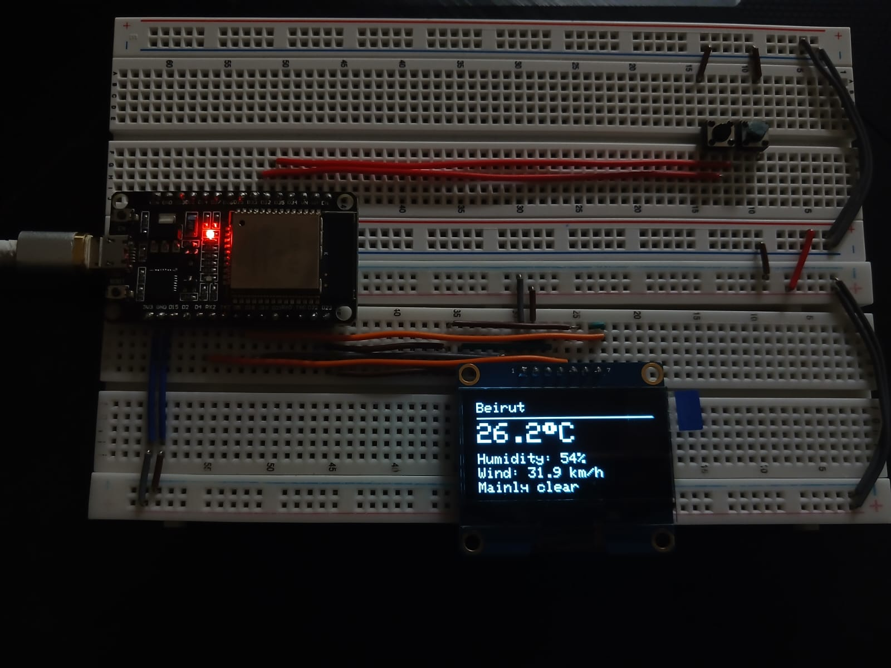

# 🌤️ ESP32 Weather Display

An ESP32-based IoT project that retrieves real-time weather information for **24 Lebanese cities and towns** using the **Open-Meteo REST API** and displays it on a **128×64 SPI OLED**.

The system features two push buttons for navigating between cities and automatically updates weather information every 10 minutes.

## 📷 Hardware Implementation



## ✨ Features

- Real-time weather information over Wi-Fi.
- Temperature (°C), humidity (%), and wind speed (km/h).
- Weather conditions such as clear, cloudy, and rainy.
- Support for 24 Lebanese locations.
- Navigation using two push buttons.
- Automatic weather refresh every 10 minutes.
- Button debouncing with internal pull-up resistors.
- Modular C++ programming using `.h` and `.cpp` files.

## 🛠️ Hardware Components

- ESP32 Dev Module (ESP-WROOM-32)
- 128×64 SPI OLED display (SSD1306)
- 2 push buttons
- Breadboard and jumper wires

## 🔌 Pin Connections

**SPI OLED:**
- MOSI → GPIO 23
- SCK → GPIO 18
- CS → GPIO 5
- DC → GPIO 22
- RST → GPIO 4
- VCC → 3.3V
- GND → GND

**Push Buttons:**
- GPIO 32 → Next city
- GPIO 33 → Previous city

Both buttons are connected to GND and configured using `INPUT_PULLUP`.

## 📁 Project Structure

```text
ESP32-Weather-Display/
│
├── Esp32_Weather_Display/
│   ├── Esp32_Weather_Display.ino
│   ├── WeatherAPI.cpp
│   ├── WeatherAPI.h
│   ├── OLEDDisplay.cpp
│   ├── OLEDDisplay.h
│   └── config.example.h
│
├── Implementation.jpeg
│   
├── .gitignore
└── README.md
```

## ⚙️ How It Works

1. The ESP32 connects to Wi-Fi.
2. An HTTPS GET request retrieves weather data from the Open-Meteo API.
3. The JSON response is parsed using ArduinoJson.
4. The weather information is displayed on the SPI OLED.
5. Push buttons allow navigation between Lebanese cities.
6. Weather data refreshes automatically every 10 minutes.

## 🚀 Getting Started

**1. Clone the repository:**

```bash
git clone https://github.com/Amoussa2005/ESP32-Weather-Display.git
```

**2. Install the required Arduino libraries:**
- Adafruit SSD1306
- Adafruit GFX
- ArduinoJson (v7)

**3. Configure Wi-Fi:**

Copy `config.example.h` to `config.h` and enter your Wi-Fi credentials.

```cpp
#define WIFI_SSID "YOUR_WIFI_NAME"
#define WIFI_PASSWORD "YOUR_WIFI_PASSWORD"
#define WEATHER_REFRESH_MS 600000UL
```

The `config.h` file is excluded from Git using `.gitignore`.

**4. Upload the firmware:**

Open `Esp32_Weather_Display.ino` in Arduino IDE, select **ESP32 Dev Module**, and upload the sketch.

## 💻 Technologies Used

- ESP32 / Embedded C++
- Arduino IDE
- SPI Communication
- Wi-Fi and HTTPS
- REST API
- JSON Parsing
- Open-Meteo API

## 👨‍💻 Author

**Ali Moussa**  
Electrical Engineering Student

[GitHub Profile](https://github.com/Amoussa2005)

---

*An embedded systems and IoT project combining hardware interfacing, network communication, and modular C++ programming.*
